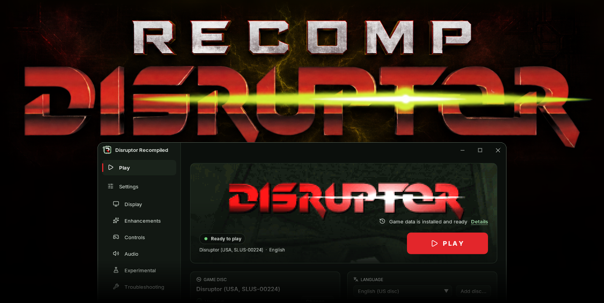
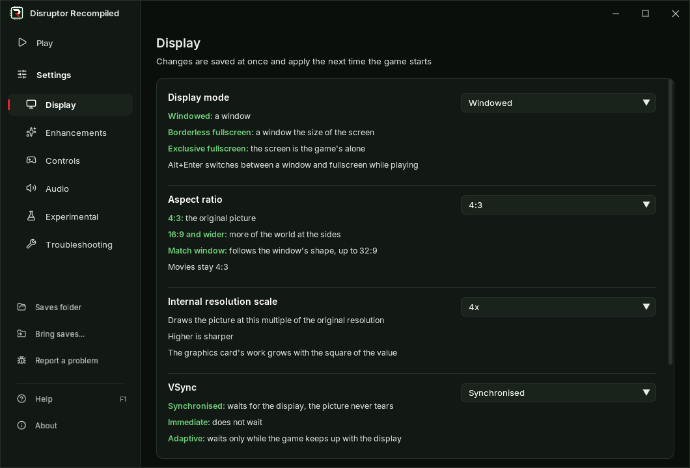
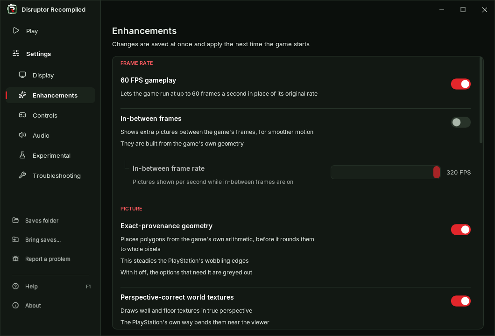
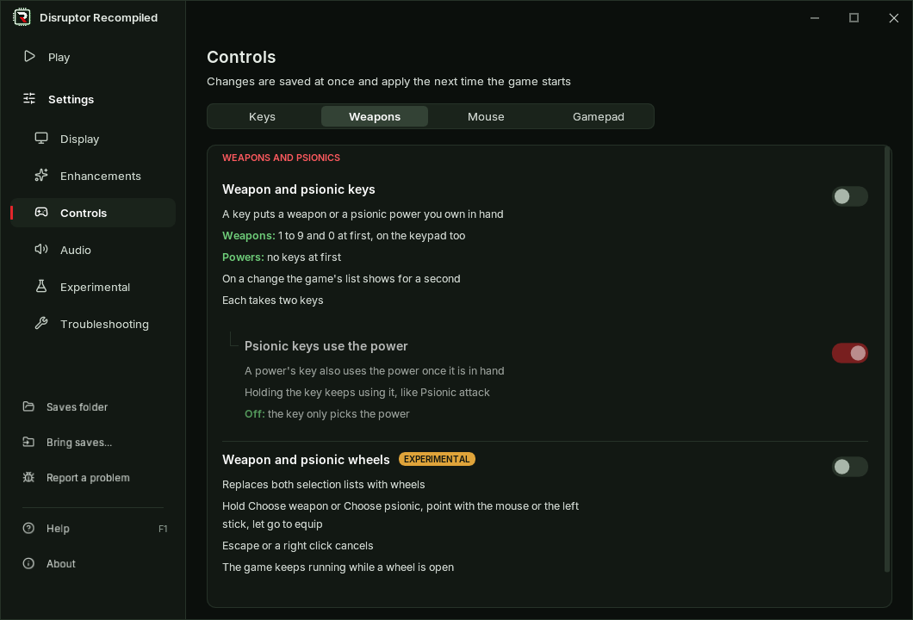
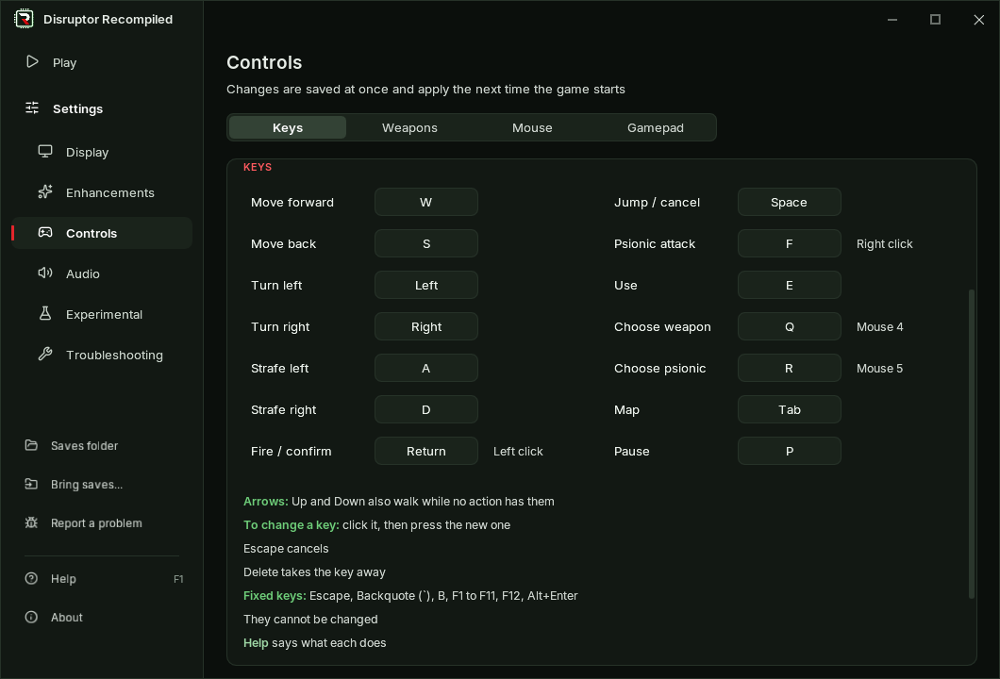

  

  A native PC recompilation of <b>Disruptor</b> (PlayStation, 1996)

  
  
  
  
  
  
  

## Quick start

1. Download from [Releases](https://github.com/RecompTeam/DisruptorRecomp/releases):
    - **Windows:** run [**DisruptorRecomp-win-Setup.exe**](https://github.com/RecompTeam/DisruptorRecomp/releases/latest/download/DisruptorRecomp-win-Setup.exe)
    - **Windows, without installing:** unpack [**DisruptorRecomp-win-Portable.zip**](https://github.com/RecompTeam/DisruptorRecomp/releases/latest/download/DisruptorRecomp-win-Portable.zip) and run `Disruptor Recompiled.exe`
    - **Linux x64:** download [**DisruptorRecomp.AppImage**](https://github.com/RecompTeam/DisruptorRecomp/releases/latest/download/DisruptorRecomp.AppImage), make it executable and run it:\
      `chmod +x DisruptorRecomp.AppImage`
2. Drop your **Disruptor (USA, SLUS-00224)** disc image on the launcher it opens
3. Press **Play**

**No game data is included** - a French, German or Japanese disc of yours can give the game its language

## Launcher

- Drop your disc image on the window and press **Play**.
- Updates install with one click and keep your saves and settings.

<table>
  <tr>
    <td width="50%" valign="top">
       
      <b>Display</b> 
      How the game fills your screen
    </td>
    <td width="50%" valign="top">
       
      <b>Enhancements</b> 
      Smoother motion and a steadier picture
    </td>
  </tr>
  <tr>
    <td valign="top">
       
      <b>Controls</b> 
      Weapon and psionic keys, mouse, gamepad
    </td>
    <td valign="top">
       
      <b>Keys and buttons</b> 
      Click an action, press the new key
    </td>
  </tr>
</table>

## Settings

| | Setting | Default | What it changes |
| --- | --- | --- | --- |
| **Picture** | Internal resolution scale | 4x | Up to 8x the original resolution |
| | Aspect ratio | 4:3 | 16:9, 21:9, 32:9 or the window's shape |
| | Anti-aliasing (MSAA / SSAA) | Off | Smoother edges, experimental |
| | Movie filter | Smooth | Movies drawn smoothly at your screen's size, without their square blocks |
| **Motion** | 60 FPS gameplay | On | The game runs at up to 60 FPS instead of 30 |
| | In-between frames | Off | Adds frames for smoother motion, up to 320 FPS |
| | Smooth mouse turning | On | The view turns between the game's 256 heading steps |
| **World** | Exact-provenance geometry | On | Steadies the polygon edges that wobble on the PlayStation |
| | Perspective-correct world textures | On | Textures keep their shape near the viewer |
| | Gap filling | On | Closes hairline gaps between polygons |
| | Depth-sorted world | On | Draws a near polygon over a far one where the game's own order gets it wrong |
| | Smooth distance fade | On | Walls fade evenly instead of in twelve steps, distant ones fade in instead of appearing in blocks |
| | Draw distance | Original | 1.25x draws the world a quarter further |
| | Ambient occlusion | Off | Shaded corners and floors under things |
| **Controls** | Control scheme | Modern | WASD and the mouse, or the original keys |
| | Weapon and psionic keys | Off | Two keys a weapon or power, 1 to 9 and 0 at first |
| | Psionic keys use the power | On | A power's key uses the power too, once it is in hand |
| | Weapon and psionic wheels | Off | Choose a weapon or a psionic on a wheel instead of the game's list, experimental |
| | Vertical mouse look | Off | Looks up and down with the mouse, which the original cannot, experimental |
| **And more** | | | HUD size, VSync, mouse sensitivity, gamepad buttons, the bass of the sound, a skip of the intro and others, all in the [player's guide](docs/PLAYING.md#settings) |

---

  <a href="docs/PLAYING.md">Player's guide</a> ·
  <a href="docs/DISC.md">Supported disc</a> ·
  <a href="CHANGELOG.md">Changelog</a> ·
  <a href="docs/STATUS.md">Status</a> ·
  <a href="docs/BUILD.md">Build from source</a> ·
  <a href="CONTRIBUTING.md">Contributing</a>

