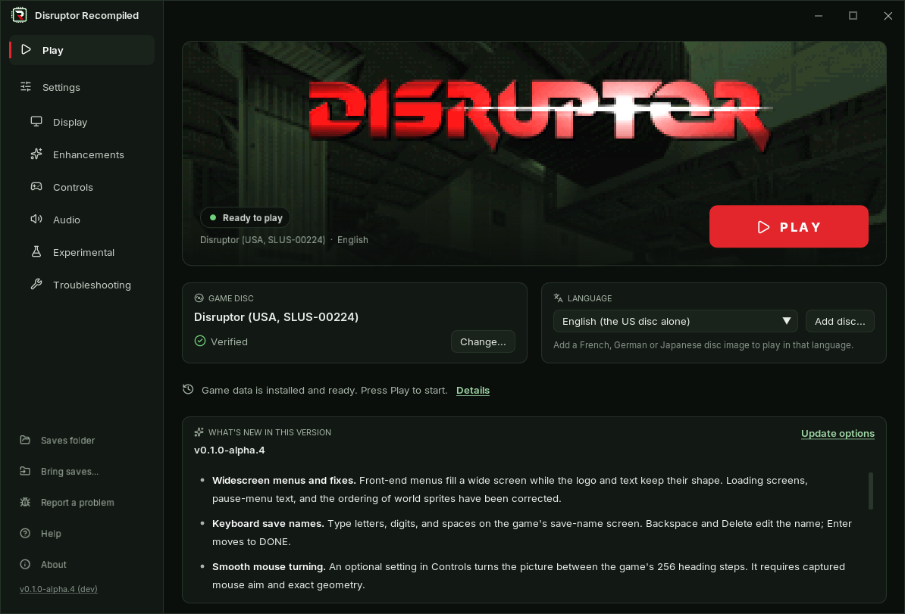
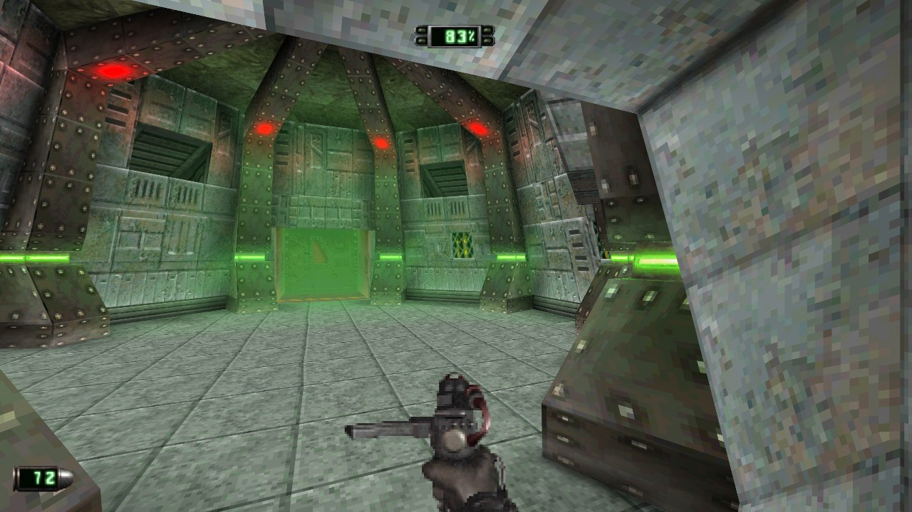
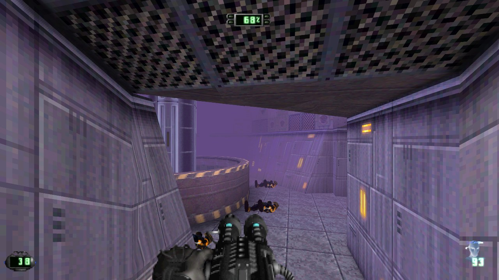
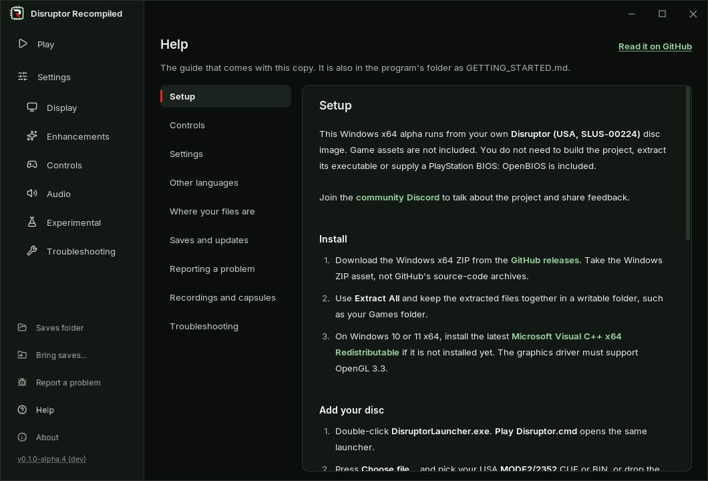

<p align="center">
  
</p>

<p align="center">
  <a href="https://github.com/RecompTeam/DisruptorRecomp/releases"></a>
  <a href="https://github.com/RecompTeam/DisruptorRecomp/releases"></a>
  <a href="https://github.com/RecompTeam/DisruptorRecomp/actions/workflows/build.yml"></a>
  
  <a href="https://discord.gg/hWbFatkXpU"></a>
</p>

<p align="center">
  <b>Disruptor</b> (PlayStation, 1996), recompiled into a native Windows program.<br>
  Bring your own disc. <a href="https://github.com/RecompTeam/DisruptorRecomp/releases/latest"><b>Download</b></a>
</p>

<table>
  <tr>
    <td width="50%" valign="top">
      <br>
      <b>Launcher</b><br>
      Drop the disc, press Play. The image is checked byte for byte.<br>An installed copy updates from here, an unzipped one by hand.
    </td>
    <td width="50%" valign="top">
      <br>
      <b>Picture</b><br>
      Up to 8x resolution, widescreen to 32:9, walls that no longer wobble.
    </td>
  </tr>
  <tr>
    <td valign="top">
      <br>
      <b>Controls</b><br>
      Modern or Classic, mouse aim and a gamepad beside the keyboard.
    </td>
    <td valign="top">
      <br>
      <b>Frame rate</b><br>
      60 FPS gameplay and in-between frames from the game's own geometry.
    </td>
  </tr>
  <tr>
    <td valign="top">
      <br>
      <b>Keys and buttons</b><br>
      Any key and gamepad button can be moved. Click it, press the new one.
    </td>
    <td valign="top">
      <br>
      <b>Help and reports</b><br>
      The whole guide inside the launcher. One button gathers a bug report.
    </td>
  </tr>
</table>

## Quick start

| | |
| --- | --- |
| **1** | Download the [Windows x64 ZIP](https://github.com/RecompTeam/DisruptorRecomp/releases/latest) and extract it. |
| **2** | Open `DisruptorLauncher.exe` and drop your **Disruptor (USA, SLUS-00224)** disc image on it. |
| **3** | Press **Play**. |

No game data is included. A French, German or Japanese disc of yours can give the game its language.

## Settings

| Setting | At first | What it changes |
| --- | --- | --- |
| Internal resolution scale | 4x | Up to 8x the original resolution |
| Aspect ratio | 4:3 | 16:9, 21:9, 32:9 or the window's shape |
| Exact-provenance geometry | On | No wobbling edges |
| Perspective-correct world textures | On | No bending near the viewer |
| Gap filling, depth-sorted world, smooth distance fade | On | No cracks, no far over near, no fade steps |
| Ambient occlusion | Off | Shaded corners and floors under things |
| 60 FPS gameplay, in-between frames | Off | Up to 60 FPS, and pictures in between |
| Control scheme | Modern | WASD and the mouse, or the original keys |
| Anti-aliasing (MSAA / SSAA) | Off | Smoother edges, experimental |

## Documentation

| | |
| --- | --- |
| [Player's guide](docs/PLAYING.md) | Controls, settings, languages, saves, troubleshooting |
| [Changelog](CHANGELOG.md) | What changed in each release |
| [Supported disc](docs/DISC.md) | The one revision that works, with its hashes |
| [Build from source](docs/BUILD.md) | Windows and Linux builds, tests, replay capsules |
| [Status](docs/STATUS.md) | What is tested and what is known to be off |
| [Contributing](CONTRIBUTING.md) | How changes are made and checked |
| [Discord](https://discord.gg/hWbFatkXpU) | Questions and feedback |

<details>
<summary><b>Build from source</b></summary>

Git, Python 3.10+, CMake 3.20+ and Visual Studio's **Desktop development with C++**, and your disc's files in `input/`
([DISC.md](docs/DISC.md)). From an x64 developer PowerShell:

```powershell
powershell -ExecutionPolicy Bypass -File .\build.ps1
.\run.ps1
```

[BUILD.md](docs/BUILD.md) has Linux, the generated code and the tests.
</details>

<sub>Built on <a href="https://github.com/mstan/psxrecomp">PSXRecomp</a>. Early alpha: the whole campaign is not tested yet. <a href="THIRD_PARTY_NOTICES.md">Third-party notices</a>.</sub>
