# Before and after

What changed from the PlayStation version. Each pair shows the same moment
twice, with one setting or one fix between the two sides.

[Picture](#picture) · [Motion](#motion) · [Widescreen](#widescreen-fixes) ·
[Fixes](#fixes) · [Additions](#additions)

## Picture

### Widescreen

16:9, 21:9, 32:9 or the window's own shape. Setting: Display, Aspect ratio.

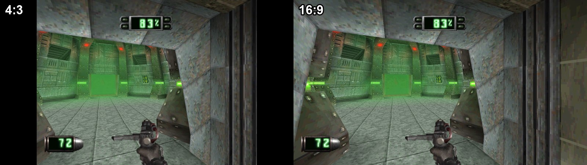

The front-end menus fill a wide screen too, while the logo and text keep their
shape.

### Resolution

Up to 8 times the original resolution. Setting: Display, Internal resolution
scale.

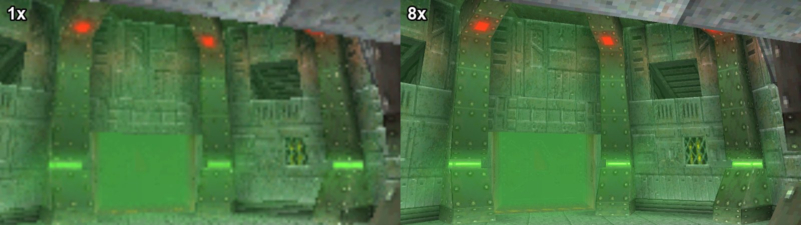

### Perspective-correct textures

Wall and floor textures keep their shape near the viewer. The PlayStation draws
them without perspective, so they bend. Setting: Enhancements,
Perspective-correct world textures.

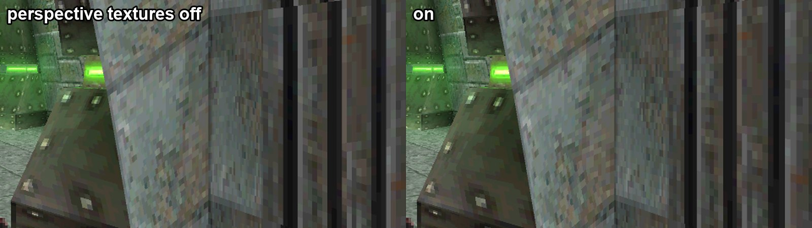

### Ambient occlusion

Shaded corners and floors under things. Setting: Enhancements, Ambient
occlusion.

### Gap filling

Closes hairline gaps between the world's polygons. Setting: Enhancements, Gap
filling.

### Anti-aliasing

Smooth polygon edges with MSAA. SSAA smooths textures and cut-out outlines too.
Setting: Experimental, Anti-aliasing (MSAA / SSAA).

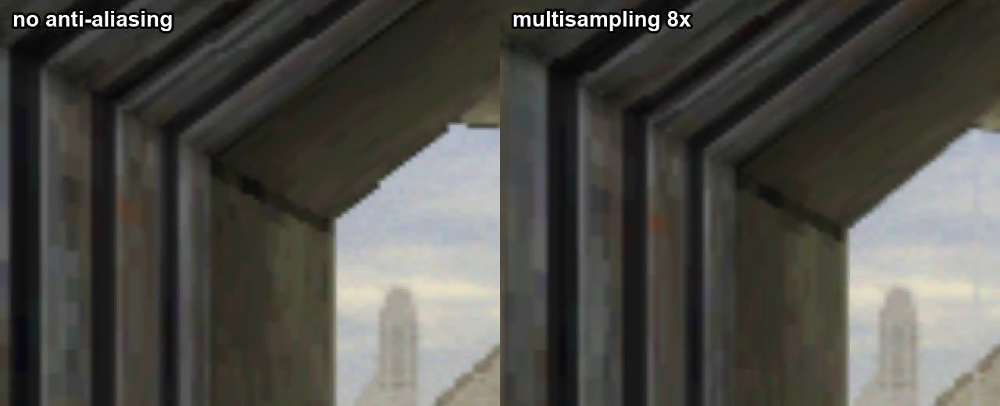

https://github.com/user-attachments/assets/4fab2b39-ee15-4bd0-90b7-cb9a489defa4

### Distance fade

Walls fade evenly into the distance, not in twelve steps. Setting:
Enhancements, Smooth distance fade.

https://github.com/user-attachments/assets/18d72d5a-d97b-426f-b8c3-2ece88bc2b7a

### HUD size

The HUD at 100, 75 or 50 percent in widescreen. Setting: Display, HUD size.

## Motion

### 60 FPS gameplay

The game runs at up to 60 frames a second instead of 30. On at first. Setting:
Enhancements, 60 FPS gameplay.

https://github.com/user-attachments/assets/5f97b82d-a4f8-47ae-b480-0b1af28d0d4f

### In-between frames

Extra pictures between the game's frames, built from its own geometry, up to
320 FPS. Here at 120 FPS, played at half speed so a 60 Hz screen shows them.
Setting: Enhancements, In-between frames.

https://github.com/user-attachments/assets/702ddb03-eae8-4862-b6a7-a89b3ff51e55

### Exact geometry

Polygons are placed from the game's own arithmetic before it rounds them to
whole pixels, so edges stop wobbling as the view moves. On at first. Setting:
Enhancements, Exact-provenance geometry.

https://github.com/user-attachments/assets/dc9d1371-fdf6-43f2-a115-f12fd73fa969

### Doors and lifts

Under 60 FPS gameplay doors and a ridden lift move on every frame. The game
itself moves them on every second one.

https://github.com/user-attachments/assets/9daead25-f4f9-4de1-a94a-3ded5a5158fe

https://github.com/user-attachments/assets/fbf2a24d-78d5-49a3-95f1-155ad038e51f

## Widescreen fixes

### Menus

### Weapon and psionics lists

The lists stay in one piece.

### Map

The map opens at its own shape, and the frame after it closes is whole.

### Pause menu

NO stays beside YES.

### Sky

No green bands over the sky backdrop.

### Held weapon

The baton keeps its size at any HUD size and rests against the screen edge.

https://github.com/user-attachments/assets/338d571d-c7fc-4327-a94f-9507691f8e94

### Pickups and bodies

Pickups and bodies are no longer cut off by the floor.

### Sprites at the edges

Pickups and bodies stay drawn until they leave a wide picture.

https://github.com/user-attachments/assets/11adc537-0bf3-4285-b488-130fcacbc728

### Holes at the sides

No holes at the screen's sides along a near wall.

### Level end

The picture stays wide while the game fades its last frame.

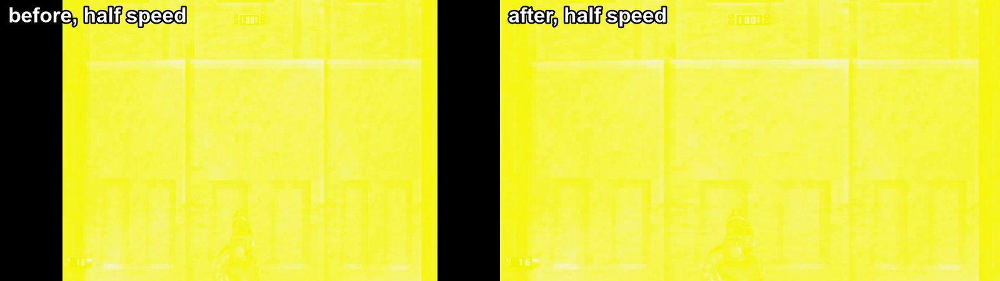

https://github.com/user-attachments/assets/a13e90d0-2d0b-4678-b8bf-f824a50c31ab

## Fixes

### Movies

No noise around the movies, and the last 8 columns of a movie are no longer
black.

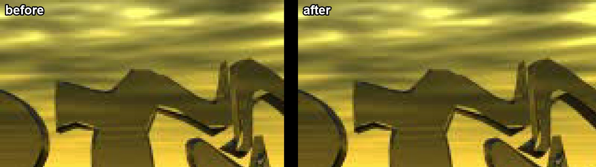

### Walls beside the player

A wall right beside the player is drawn whole.

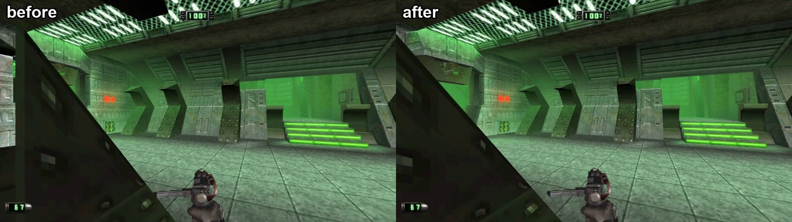

https://github.com/user-attachments/assets/02f46b1f-3a20-44d0-b482-ddcadfc82aa2

https://github.com/user-attachments/assets/93dceda7-572d-424a-b25f-6a29675fe926

### Bodies on the floor

A body lying on the floor stays whole.

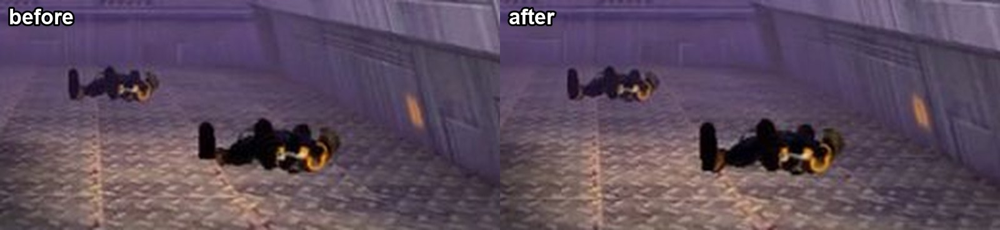

https://github.com/user-attachments/assets/e885217b-64a6-4b56-ae6e-c287d9d5b96e

### Turning with the mouse

Under smooth mouse turning the sky and the sprites turn with the world, and a
far corner is no longer thrown across the screen.

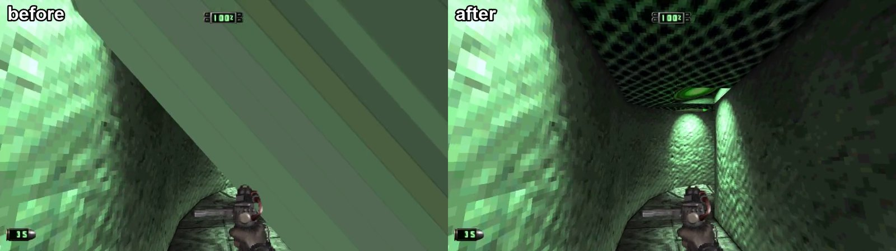

https://github.com/user-attachments/assets/30c1e1b1-8ae8-46e4-bfcc-ef6a85d06718

https://github.com/user-attachments/assets/5b7de9cb-1ca9-4cf8-9808-21bcbbc1483c

https://github.com/user-attachments/assets/3a7d133b-687e-4b74-8165-fc24210892e6

### Doors

A pickup or a body under a shut door stays behind the door, close up and from
afar. From afar the PlayStation version drew it over the door too.

https://github.com/user-attachments/assets/cd1264ca-88bd-4d3b-973d-a3bb28c76b2d

https://github.com/user-attachments/assets/cfac940d-ce53-4aaa-96cc-377de77081bb

### Stairs

A drone under the stairs stays behind the floor in front of it.

https://github.com/user-attachments/assets/36332a65-3204-4031-809d-11068ea16ac1

### Windows and columns

The sky stays in a window while the view turns with in-between frames, here at
half speed. No dark rim hangs beside a column.

https://github.com/user-attachments/assets/e50ffa37-8ae4-4e23-a2a2-cfd0e9a9ad28

https://github.com/user-attachments/assets/9017f18a-6e99-40a9-8802-a60f28e754ea

### French and German discs

Mission 1's floor and stairs have their textures, the drones' shadows are
round, and the pause menu's quit question stands where the PAL version puts it.

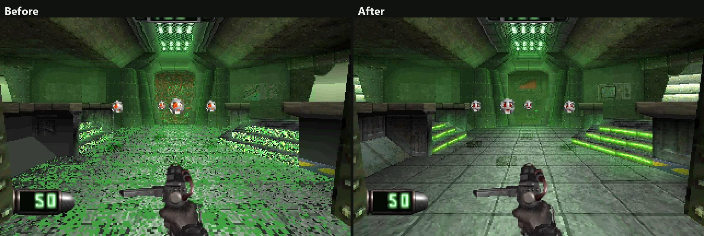

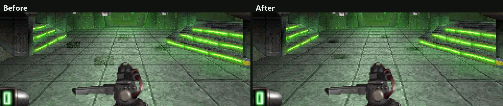

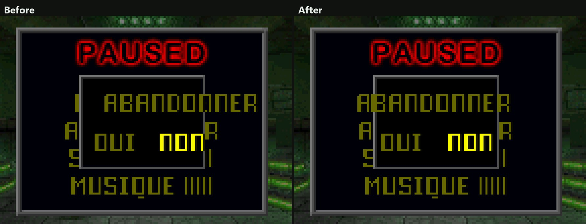

## Additions

### Languages

A French, German or Japanese disc of yours gives the game its text and signs.

### Save names from the keyboard

Type a save's name with letters, digits and spaces.

